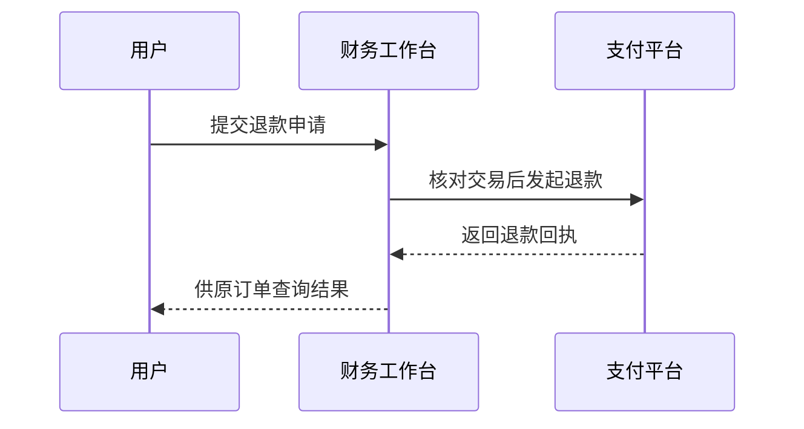

# 预约退款业务梳理

本示例使用虚构规则及界面。页面实测和批准规则均未核实。

## 1. 范围、角色与核心对象

从用户发起预约退款开始，到财务处理并由用户查询结果。参与方为用户、财务人员和支付平台。

| 业务术语 | 准确定义 | 代码 / 库表对应标识 | 易混淆概念 |
| --- | --- | --- | --- |
| 退款申请 | 用户要求退回预约款的记录 | 示例编号 R01 | 支付交易 |
| 退款回执 | 支付平台返回的资金处理结果 | 示例编号 P01 | 退款申请提交提示 |

## 2. 端到端主流程与分支

### 项目全业务串讲

用户在预约订单详情提交退款申请，随后可以查看处理进度。财务人员从退款工作台找到这笔申请，核对原预约和支付交易后发起退款。支付平台返回回执后，财务人员从原申请核对资金结果，用户也到原订单回查。支付平台返回失败时，财务先复核回执再决定处理方式，用户保留原申请作为查询依据。申请和资金回执各按自己的编号核对。

### S01 提交退款申请

用户在预约详情选择原预约并提交申请，财务从退款工作台接手。同一申请在工作台何时可见待确认。

### S02 **核对并发起退款**

财务按原预约号和支付交易核对申请，发起后等待支付平台回执。回执成功时，用户在原订单查看结果。

### S02-1 处理退款失败

财务在退款详情核对失败回执并记录处理结果。是否允许重试待确认。

## 3. 规则与统计口径

| 触发 | 条件 | 结果 |
| --- | --- | --- |
| 财务处理退款 | 找到对应预约和原交易 | 发起退款并等待回执 |
| 财务收到失败回执 | 退款失败 | 复核原交易和退款申请 |

## 4. 相关模块与业务边界

预约详情提供申请入口，财务工作台处理退款。取消预约与资金退回的接口关系待核实。

## 5. 待确认问题

| 编号 / 步骤 | 待确认问题 | UI 实测证据 | 代码实现证据 | 确认口径证据 | 业务影响 | 确认责任人 |
| --- | --- | --- | --- | --- | --- | --- |
| Q01 / S02-1 | 失败后能否重试 | 未核实 | 虚构示例 | 未核实 | 重复退款防护 | 财务负责人 |

## 6. 口述回顾

用户从原预约提交退款，财务核对并发起退款，有回执后回查原订单，失败由财务继续处理。
