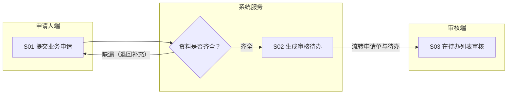
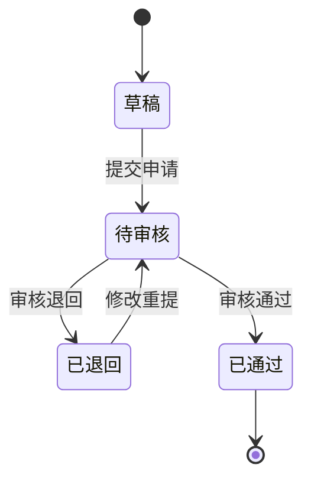
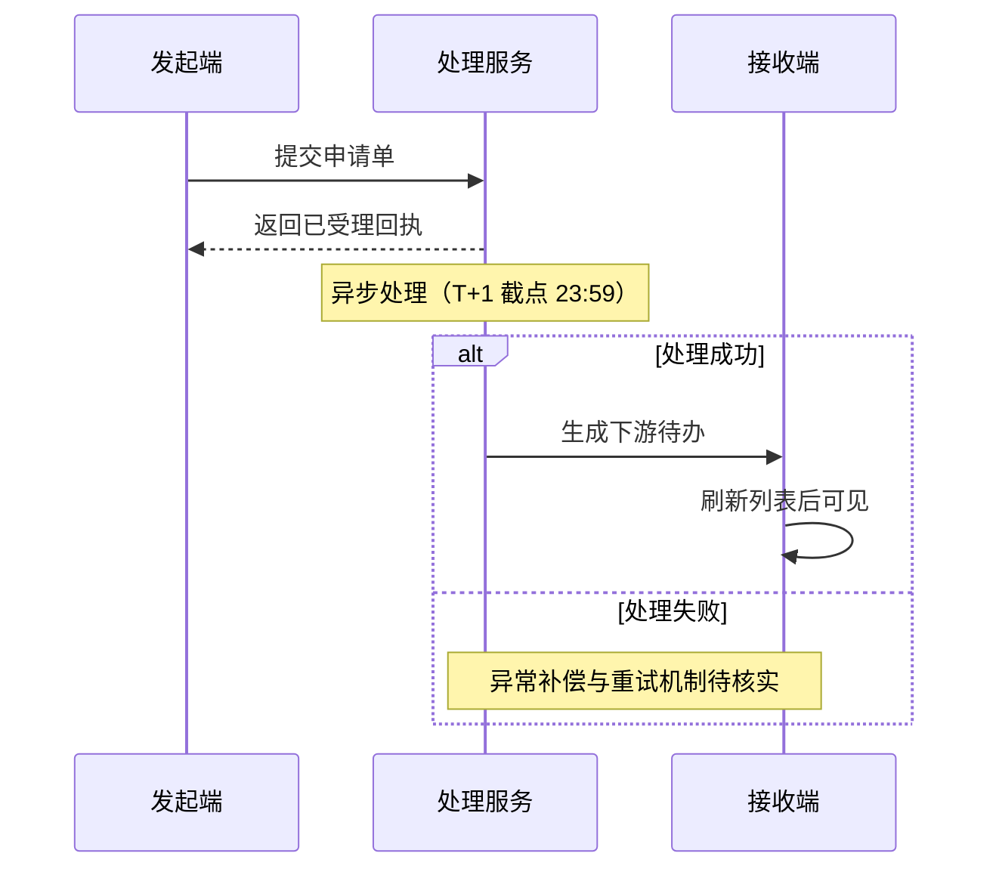

# Modeling, Mermaid, and Methods

Prefer the [interactive HTML flowchart](html-flowchart.md) for a complete cross-surface workflow. Use Mermaid for chat previews and local explanations within Markdown. Select diagrams relevant to the request. Use English node/state IDs and Simplified Chinese display labels directly, and mark unverified conditions, nodes, and timing explicitly.

## 1. Workflow

Use a Mermaid `flowchart` with role or system `subgraph` lanes. Show visible actions, handoff objects, conditions, and destinations.

## 2. State

Use `stateDiagram-v2` for each relevant entity. Label trigger events, initial and final states, and applicable return or reopen paths.

## 3. Cross-surface sequence

Use `sequenceDiagram` for synchronization, asynchronous work, external exchange, or T+1 visibility. Separate submission, acknowledgment, downstream work, and visibility. Use `alt` for meaningful failure paths. For T+1 specify cutoff and day definition.

## 4. Entity relationships

When record identity or counting granularity matters, use a table or optional `erDiagram`.

| 来源实体 | 关系与基数 | 目标实体 | 关联依据 | 创建时机 | 缺失或重复关联处理 |
|---|---|---|---|---|---|

Verify owner, creation, maintenance, actual cardinality, and reuse across business cycles. Label assumptions separately.

## 5. Review

- [ ] Align roles, pages, entities, and statuses with both deliverables.
- [ ] Show triggers, destinations, and visibility conditions.
- [ ] Quote Mermaid node labels, e.g. `A1["S01 提交业务申请"]`.
- [ ] Split diagrams above 12 nodes or with dense branches into a main diagram and branch diagrams.

## 6. Method selection

Use formal notation only when the deliverable requires it.

| Method | What to use | When |
|---|---|---|
| BPMN | Role lanes, trigger events, and conditional handoffs | Cross-team workflows and exceptions |
| DMN | Condition-to-outcome tables and priority checks | Complex or overlapping business rules |
| IIBA business analysis | Traceability between current behavior, expected behavior, and stakeholder evidence | Existing-system discovery and disagreements |
| Gherkin | Given / When / Then examples with observable outcomes | Integration walkthroughs and acceptance cases |

Primary references: [OMG BPMN 2.0.2](https://www.omg.org/spec/BPMN/2.0.2/) · [OMG DMN](https://www.omg.org/dmn/) · [IIBA Business Analysis Standard](https://www.iiba.org/knowledgehub/the-business-analysis-standard/4-implementing-business-analysis/4-4-understanding-requirements-and-designs/) · [Cucumber Gherkin Reference](https://cucumber.io/docs/gherkin/reference/)
